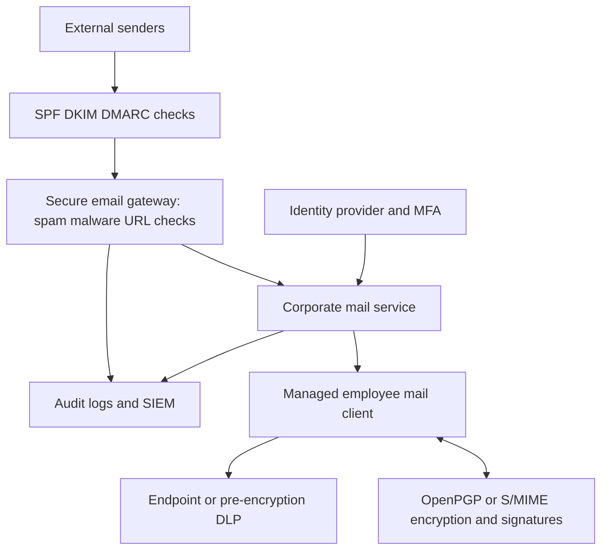

# Secure Email Architecture Design

## Scope and assumptions
Reference design for a global consulting firm, demonstrated in an isolated lab. This is **not** a production deployment or a claim that First Quadrant Labs' systems were inspected. Confirm business requirements, mail provider, domain ownership, data classification and applicable jurisdictions before implementation.

## Logical architecture

## Components
| Component | Example options | Design guidance |
|---|---|---|
| Email service | Microsoft 365 / Google Workspace / isolated Postfix-Dovecot lab | Managed production service preferred for operational resilience |
| Mail client | Thunderbird / Outlook | Support signed/encrypted messages and managed updates |
| Identity | Provider identity platform | Require MFA, conditional access, least privilege and account recovery |
| Encryption | OpenPGP / S/MIME | Manage keys/certificates, revocation, trust and recovery |
| Domain auth | SPF / DKIM / DMARC | Publish DNS only on owned domain; align legitimate senders before enforcement |
| Gateway | Provider-native protection / Proxmox Mail Gateway lab | Malware, phishing, spam, quarantine, alerting |
| DLP | Provider-native or endpoint DLP | Classify data and inspect before E2EE; use synthetic tests |
| Logging | SIEM / mail audit logs | Restrict access, redact personal data and apply retention limits |

## Data flow and trust boundaries
1. Inbound email reaches authorized MX/gateway, where sender-domain authentication and filtering are assessed.
2. Approved email is delivered to the mailbox service over protected connections.
3. Employee authenticates using MFA and accesses email using a managed client.
4. Sensitive mail is encrypted and signed at the endpoint using the recipient's verified public key/certificate.
5. Outbound classification and DLP occur before endpoint encryption, where feasible.
6. Alerts and audit events flow to restricted logging.

## Key security considerations
- STARTTLS protects transport hops, not message content at every server.
- SPF checks authorized sending hosts; DKIM signs selected message headers/body; DMARC evaluates domain alignment and policy. None replaces user identity verification.
- S/MIME and OpenPGP require secure key provisioning, revocation, backup and trust verification.
- Gateways cannot normally inspect end-to-end encrypted content; endpoint DLP and metadata policies are necessary.
- Separate administration, mailbox and auditor roles. Keep encrypted backups and test restoration.

## Deployment stages
1. Inventory senders, recipients, domains, mail flows and sensitive data.
2. Baseline MFA, logging, DNS and TLS.
3. Pilot encryption/signatures and user training.
4. Introduce filtering, DLP and incident workflows in monitor mode.
5. Validate false positives and business continuity; progressively enforce.
6. Record evidence, exceptions, ownership and quarterly review.
